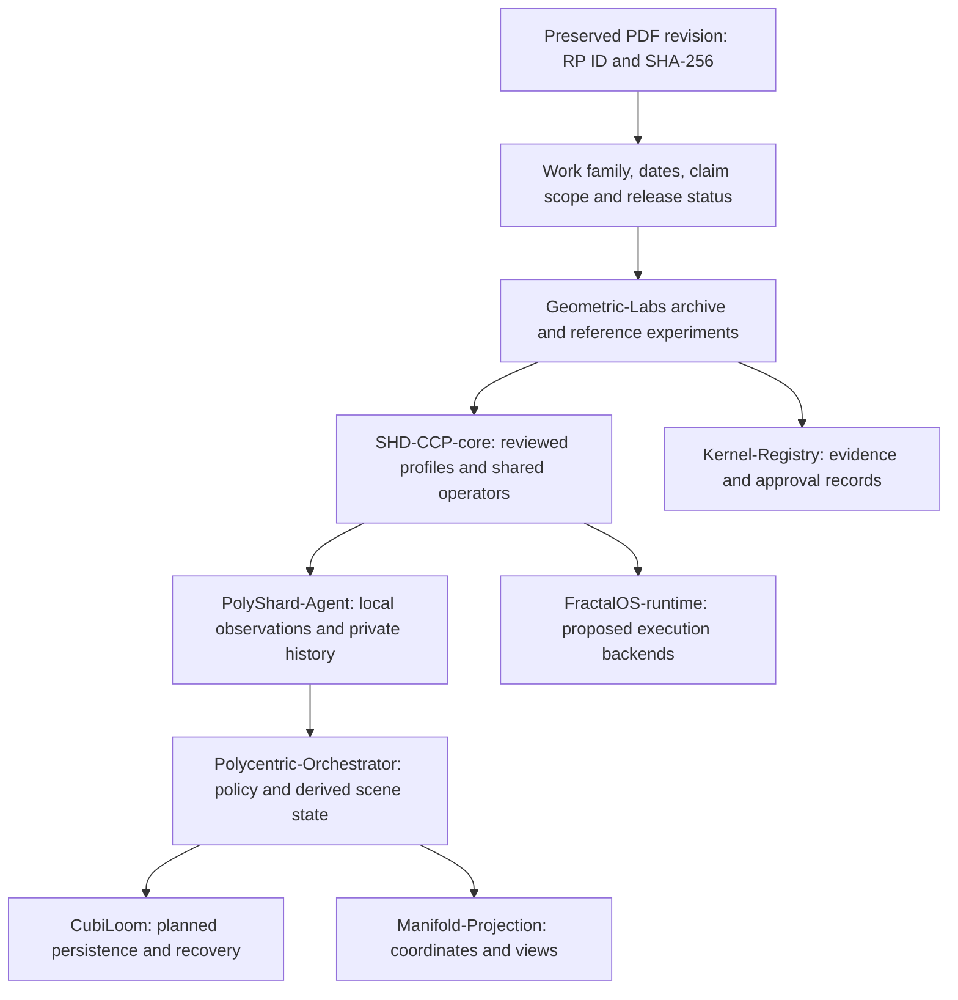

# How the first papers fit the architecture

Reviewed for relevance on 2026-10-26. Follow each RP link in [INDEX.md](INDEX.md) for the
original PDF, page citations, interpretation limits and next review. These relationships
describe proposed application; they are not evidence that the components implement it.

## A reading order by subject

| Group | Papers | Start here | Practical use |
| --- | --- | --- | --- |
| Geometric foundation and views | RP-0001, RP-0002, RP-0010, RP-0006 | RP-0001 for vocabulary, then RP-0006 for scope | Separate torus views, S³ states, angular winding and physical frames |
| Folded visual features | RP-0003 | PDF §3, three overlapping quadratic windows | AlexNet-H/GEOT FoldedTriQuad experiment in Geometric-Labs |
| Rational local routing | RP-0005 | Definitions 1 and 4; sparsemax; Remark 22 | Exact reference operators and controlled float-model comparisons |
| Memory and offload | RP-0004, RP-0009, RP-0007 | RP-0009 §15 and RP-0007 M1 before implementation | CubiLoom replay/recovery design, private histories, runtime numeric boundaries |
| Certification and calibration | RP-0008, RP-0011, RP-0006 | RP-0008 abstract/circularity; RP-0011 uncertainty and corrections | Exact certifiers, explicit frame/calibration evidence and release review |

## The immediate AlexNet-H/GEOT connection

RP-0003 directly motivates the three-fold/eight-layer quadratic windows. RP-0005 motivates
the rational Lorentz lift, quadrance and sparsemax reference. The implemented learned model
uses floats and a restricted latent-spinor annulus; its separate Fraction oracle does not
make the whole neural network exact. Its current classifier and semantic outputs are untrained.

RP-0004/RP-0009 and RP-0007 motivate later temporal-memory experiments; neither is currently
an implemented learned temporal memory module or persistent CubiLoom backend. RP-0001/RP-0002
suggest geometric views, without converting latent vectors into measured positions.
RP-0011 provides calibration context for actual observations; it does not calibrate network
confidence. RP-0008 motivates an exact-certification boundary, separate from learned scoring.
RP-0006 supplies the broad vocabulary and flags profile-level differences needing review.

A practical promotion sequence is: reproduce the small operators in Geometric-Labs, train
and compare controlled visual models, agree a typed observation contract, implement receiver
validation/materialization, then add persistent memory and a runtime backend. Each step needs
its own acceptance evidence and component review.

## Differences to retain while consolidating

| Issue | Source connection | Archive interpretation |
| --- | --- | --- |
| Golden radii versus winding frequency | RP-0001 pp. 3–4; RP-0006 Lemma 11 | Irrational frequency ratio must be specified separately; finite precision remains bounded |
| General quaternions versus a torus | RP-0002 §§2–3 | A fixed torus is 2D; S³ is 3D. Restrict the domain or declare information loss |
| Prime soliton narrative versus exact certification | RP-0002 §4; RP-0008 abstract and §5 | A stochastic proposer is not a prime oracle; record the later source's correction without silently rewriting the earlier PDF |
| Triple-Quad Function versus exact TQF | RP-0003 §3; core Gram identity | Separate operator names/domains. Three quadratic outputs do not uniquely reconstruct eight arbitrary values |
| Sparsemax versus a full pump | RP-0005 §§7–9 and Remark 22 | S and valve-modified K differ; base-referenced current does not establish stationary circulation of K |
| Unit norm versus coordinate bit width | RP-0007 M2, PDF p. 4 | Counterexample: h × doubled (1,1,1,1) = (0,0,2,0), same norm but larger maximum coordinate |
| Coarse product versus fine history | RP-0009 §15; RP-0007 M1/M2 | Preserve residual history; parity and interpolation do not provide unlimited compression |
| Proposed Tile semantics versus frozen profiles | RP-0006 §6.1 | Form-1 loss flag/normalization and codex proposals are not adopted automatically |
| Computed metrology versus measurement | RP-0011 §§3, 7 and appendices | Require actual instrument/environment/uncertainty records; paper budget is not a default guarantee |
| Claimed source scripts versus reproduced tests | RP-0006 Appendix A; RP-0007 §6 | Embedded logs/named scripts are not standalone code supplied in this batch |

## Unresolved material for future batches

- Earlier differently encoded Fifteen Lemmas PDF: distinct bytes, revision order unknown.
- *Metrological Foundations*, the predecessor explicitly named in RP-0011.
- *Open Problems of the Geometric Engine* and *Audit and Revision Record of the Fifteen Lemmas*, named in RP-0006.
- Original scripts named in PDF appendices, including `verify_memory.py`; preserve hashes and environments when supplied.
- Earlier chronometry, sieve companion, sumption-cycle and remaining series papers: not silently included in this initial eleven-file intake.

This is a backlog of identified sources, not a claim that those artifacts are present or reviewed.
