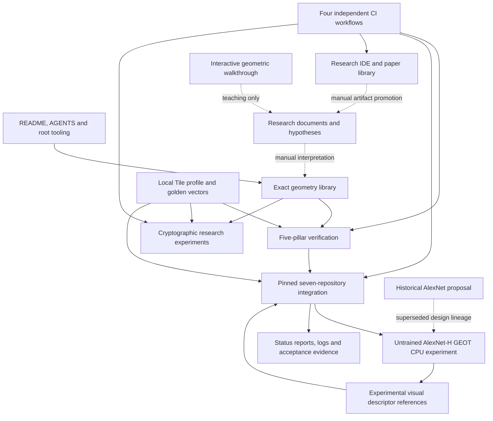
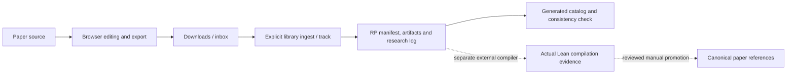
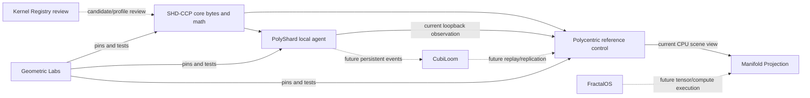

# Geometric-Labs checkpoint — 25 October 2026

**Read this as a map, not as a claim that every research idea is implemented.**
The repository is a mathematical verification lab, multi-repository integration
workspace, experimental visual-model testbed, and research/artifact organizer.
It is not yet a production distributed database, trained foundation model,
certified cryptographic platform, formal-proof collection or bootable OS.

**Audited revision:** `5740846e07f313aed4bee9038ceb740436b50899` (freshly fetched main).
**Coverage:** all 229 tracked paths classified into 13 sections,
plus the separately pinned seven-repository dependency manifest. This is a
structural/source-and-command audit, not a line-by-line security review.
Ignored clones, venvs, uploaded chat attachments and Git internals are excluded.
The checkpoint files themselves are new and excluded from the original 229-file
snapshot. See [every source path and hash](inventory.json).

[Open the interactive map](index.html) · [Machine-readable relationships](map.json)

## 1. The whole project at a glance

Solid arrows describe existing code/test use or invocation; dashed arrows describe
manual/reference relationships. This is a relationship map, not a strict build
DAG: orchestration can invoke components that also consume its adapters.
No arrow from research to implementation implies automatic proof or generation.

## 2. Every repository section

| Section | Tracked files | What belongs here | Current state |
|---|---:|---|---|
| Project entry and operating rules | 6 | `root` | implemented |
| Canonical documentation and paper intake | 5 | `docs/` | reference |
| Research IDE and paper library | 17 | `Research_IDE/` | implemented |
| Exact geometry library | 23 | `src/geometric_labs/` | implemented |
| Local wire profile and golden vectors | 7 | `spec_sync/` | implemented |
| Five-pillar reference verification | 24 | `verification/` | implemented |
| Cryptographic research line | 45 | `Cryptographic_Research/` | experimental |
| Seven-repository integration control | 21 | `ecosystem/` | implemented |
| AlexNet-H/GEOT RFC 0.2 CPU reference | 33 | `ecosystem/experiments/alexneth_geot/` | experimental |
| Earlier AlexNet planning scaffold | 9 | `ecosystem/experiments/alexnet_get/` | reference |
| Ecosystem architecture and evidence | 34 | `ecosystem/docs/ and ecosystem/evidence/` | reference |
| Interactive geometric walkthrough | 1 | `interactive/` | reference |
| Automated verification workflows | 4 | `.github/workflows/` | implemented |

### Root entrypoints and rules

- `README.md`: the established math lab introduction and quick start; it does
  not yet describe every newer repository section. This checkpoint complements it.
- `AGENTS.md`: preservation, ownership, profile, privacy and review boundaries.
- `pyproject.toml`: packages only `src/geometric_labs/`; it does not install
  the optional Torch model or turn all research directories into one application.
- Root `Makefile`: math verification, pillars, vector generation/check and cleanup.
- `LICENSE` and `.gitignore`: repository license and ignored local/build files.

**Important:** root `make verify-all` currently runs 40 math/vector unittest
methods and the standalone five-pillar master. It is not an umbrella for all
140 checkpoint test methods.

### docs/ — mathematical context and canonical paper intake

`architecture_blueprint.md` describes the original lab; `specification_status.md`
records corrections, scope limits and incomplete semantics; `papers/README.md`
is a paper-intake manifest. `papers/core/` and `papers/series/` currently contain
placeholders only. No PDF is tracked there in this snapshot.

The older paper manifest's “No PDFs have been supplied” sentence describes that
repository intake, not the history of PDFs uploaded in chat. Uploads, experimental
research archives and canonical paper-library entries are different inventories.

### src/geometric_labs/ — reusable mathematics

| Module family | Files / responsibilities | Arithmetic boundary |
|---|---|---|
| Hurwitz | hurwitz.py: doubled coordinates, units, products, norms, associates, Gram-TQF | exact Python integers |
| S5 addressing | s5_hyperbolic_tree.py: shift/add steps, reduced-word recovery, abelian shadow | ordinary integer address coordinates, not doubled quaternions |
| CRT | garner_crt.py: default 881/883/887 residues, inverses and reconstruction | exact integers |
| Tile codec | tile_codec.py: fixed headers, local forms, raw opaque payloads, halo filter | exact byte layout; Form3 values are binary32 |
| Calibration | acoustic_cubit, chronometry_window, horn_frame_solver | real-air/frame estimation numerical; chronometric pulse arithmetic exact |
| Certification | wheel_30_oracle, prime_anchor_cert, merkle_12layer | proposal filtering vs prime checks vs SHA-256 chain explicitly separated |
| Blockchain | qcc_delta_chain, holonomy_prefix_scan, toroidal_state_matrix | ordered exact unit operations and discrete checkpoints; not a complete ledger |
| Threading | balancer_64stream, cubocta_12engine_ring, supercycle_24step, torus_soliton_mux, tqf_stream_pruner | exact router/schedule/closure models, not 64 OS/GPU threads |

`__init__.py` files expose/package these modules. Every Python module's top-level
symbols are listed alongside its path in inventory.json. Floating-point spinors
in the vision experiment are not interchangeable with this doubled-integer ring.

### verification/ — the five verification pillars

| Directory | Focus |
|---|---|
| 01_accessibility | float cancellation, exact Gram result, S5 recovery, spinor cycle |
| 02_calibration | Cramer cubit/GUM inputs, Cs windows, coherence and frame fitting |
| 03_certification_validation | wheel bias, prime bitmap/MR12, CRT |
| 04_quaternion_blockchain | noncommutative holonomy, Lucas checkpoints, halo/hash-chain checks |
| 05_stream_threading | 64 routes, cyclic erasure recovery, phase scheduling, pruning |

There are 16 modular pillar files, despite early source material calling them
14 suites. `verify_geometric_labs_suite.py` is the corrected standalone master;
`test_golden_vectors.py` independently consumes committed vectors. The archived
`reference/original_master_suite.py` is preserved with known failures and is not
a passing CI target. It should not be confused with a current regression.

### spec_sync/ — protocol examples and frozen conformance references

The local RFC documents field positions and explicitly provisional form semantics.
Five JSON families cover tiles, Hurwitz/S5, CRT, chains/Merkle and balancer streams.
`generate_golden_vectors.py --check` detects drift without replacing expected
outputs; ordinary generation is a deliberate fixture update, not a repair tactic.

The local fixture label `geometric-labs-reference-v1` has the explicit integration
alias `glab-local-v1`. `shdccp-proposed-v1` is a distinct upstream proposed profile.
Both current fixed-field codecs agree on Form ID bits 40–43, but form semantics
are not universally reconciled. Crypto's older ontology references flag additional
open questions; they do not override the executable local wire layout.

### ecosystem/ — integration control, not a copy of seven products

| Subsection | Responsibility |
|---|---|
| manifest/ | exact repository URLs, roles and dependency directions |
| locks/ | tested SHA identities plus manifest digest |
| tools/glab.py | list/doctor/sync/lock/check-lock; fail on dirty/unknown/wrong-origin clones |
| tools/upstreams.py | import real independent source checkouts and verify origins |
| tools/protocol_compatibility.py | C/Python/local byte agreement and explicit semantic gaps |
| tools/run_acceptance.py | command status, counts and evidence capture |
| contracts/ | profile labels and interface proposals, not automatic upstream implementations |
| simulator/ | three-agent loopback reference mesh with actual upstream modules |
| tests/ and integration_tests/ | 20 offline + 4 pinned integration test methods |
| environments/ | capability/profile descriptions; some are still design-only |
| workspaces/ | ignored independent clones; only .gitignore is tracked |
| docs/ | ownership, roadmap, compatibility matrix and status reports |
| docs/resources/ | architecture Markdown plus two reference flowchart PNGs |
| evidence/ | historical saved outputs for their stated source revisions |

Existing sync restores missing locked repositories and never silently pulls/resets
existing checkouts. Evidence reports are historical artifacts, not live monitors.

### ecosystem/experiments/ — current and historical vision work

`alexnet_get/` is the earlier planning scaffold: proposed variants/module map and
planning CLI. It is intentionally retained and points to the implemented RFC0.2
experiment; a valid planning file is not a trained model.

`alexneth_geot/` contains the actual CPU reference:

```mermaid
flowchart LR
    I[Local image] --> S[Multiscale AlexNet stem]
    S --> F[16x16 alignment and reversible fold3]
    F --> Q[Proposed folded quadratic mixer]
    Q --> C[64 latent cells]
    C --> R[Matched Euclidean or Lorentz sparsemax router]
    R --> H[Class logits and separate 64D semantic embedding]
    H --> P[Local consent/profile checks]
    P --> T[Tensor reference sidecar plus Form3 scalar Tile]
    T --> A[Independent agent/control loopback harness]
```

- `src/`: primitive tensors, rational oracle, model and sidecar validation.
- `tests/`: 16 numerical/neural/interop methods; `research/tests/`: 6 original methods.
- `research/`: verbatim supplied RFC and prototype, not 13 independently reviewed PDFs.
- `tools/`: actual interop and verification commands; `requirements-cpu-py312.txt`:
  tested optional CPU dependency snapshot, not a cross-platform hash lock.
- `docs/` and `evidence/`: architecture decisions, source inventory and actual checks.

Default model has 2,506,558 parameters and is **untrained**. The 64-cell grid is
latent, not measured 3D. Fixture points provide TQF576; the model does not infer
those coordinates. Visual-sidecar validation is local; the current generic
receiver preserves metadata but lacks remote visual-specific enforcement.

### Research_IDE/ — research artifact workbench

The browser page contains PDF/Markdown/LaTeX tools, equation/audit helpers,
flowchart editing, Lean text export and Cosmo-ID visualization. Its state must
be exported before reload; a browser badge alone is not persisted research.

The stdlib `tools/library.py` creates RP IDs, files exports into typed paper
folders, records artifact hashes, validates evidence stages and builds catalogs.
`ide.lock.json` checks the page bytes and lists browser CDN dependencies.
`WALKTHROUGH.md`, `docs/MASTER_OPERATION_GUIDE.md`, templates and tests explain
how to use it. `inbox/` is temporary/ignored; `papers/` currently has zero entries.

The default IDE nodes may say “proven,” and its export can contain illustrative
`True` snippets. Neither establishes the mathematical statements. Actual Lean
execution occurs outside the page; library `lake-verified` requires recorded
compiler evidence. This checkpoint did not run Lean or validate browser/CDN UX.

### Cryptographic_Research/ — bounded research experiments

`REGISTRY.json` and `tools/registry.py` manage CR IDs/stages and scaffolds.
`experimental/` has one entry, `CR-0001_lamport-otp`, with versioned manifest,
threat model, research log, clean-room source, tests, vectors and demo.
`published/` and `archived/` have explanatory placeholders; no published production
algorithm is currently registered. Templates and roadmap are proposals.

CR-0001 separates:

1. Classical SHA-256 Lamport challenge-style OTP baseline.
2. Exact Hurwitz walk as a candidate one-way function: **failed**; inversion is
   an expected negative research result, not a broken test to suppress.
3. Reduced-walk ideas: not implemented, with documented published attack concerns.
4. Local nine-Tile OTP framing: one Form2 CRT index plus eight opaque Form0
   password fragments; actual hash verification remains essential.

Tooling contributes 9 tests and CR-0001 contributes 29. A passing research suite
is not a security audit or authorization to deploy authentication.

### interactive/ — educational geometric simulation

The eight-step walkthrough is a separate browser visualization. It is not the
Research IDE, an AlexNet UI, a proof verifier or a network service. External
assets may be required. Its current browser behavior was not tested here.

### .github/workflows/ — four distinct automation lanes

| Workflow | Scope | Configured Python |
|---|---|---|
| verify_15_lemmas.yml | root math/master/pillars/vectors | 3.10, 3.11, 3.12 |
| ecosystem-integration.yml | offline + locked cross-repo acceptance | 3.10, 3.12 |
| research-ide.yml | library/catalog tests and page hash consistency | 3.10, 3.11, 3.12 |
| cryptographic-research.yml | registry, item tests, vectors, standalone tests | 3.10, 3.11, 3.12 |

Current automation does **not** install Torch or run the 22 visual-model and
supplied research tests. Local full-checkpoint validation therefore exceeds
current GitHub workflow coverage. This inspection did not query remote CI runs.

## 3. External ecosystem: where each product belongs

| Independent repository | Owns | Present capability / boundary |
|---|---|---|
| SHD-CCP-core | generic wire codec and geometry | C11/Python raw field implementations; full form semantics unfinished |
| Kernel-Registry | profile/candidate validation and review metadata | structural linter; no automatic proof or certification |
| CubiLoom | intended causal storage/replay/replication | current pinned checkout README/LICENSE only |
| PolyShard-Agent | local agent data and observation generation | development reference; private data stay local by default |
| Polycentric-Orchestrator | admission, coordination, derived scene | loopback development service, in-memory replay/event state |
| Manifold-Projection | derived scene projection and visualization | deterministic CPU reference and shader assets |
| FractalOS-runtime | hosted/backend execution contracts | draft Tile-job interface, not a tensor runtime or bootable OS |

All seven exact SHA/URL identities are in map.json and ecosystem/locks/commits.lock.json.
Optional `BioChain-AI` is a separate legacy integration and is excluded by default.

These are responsibilities, not completed deployment links:

## 4. The registries are different systems

| Name | What it tracks | What it does not establish |
|---|---|---|
| Research IDE CATALOG/RP manifests | paper artifacts and lifecycle | protocol approval, model quality or automatic proof |
| IDE embedded 69-check registry | page audit/reference metadata | executable repository conformance |
| Cryptographic REGISTRY/CR manifests | algorithm research items and epistemic status | production security certification |
| External Kernel-Registry | candidate layout checks/review process | scientific truth or blanket tool authority |
| Ecosystem manifest and lock | repositories and tested source identities | dependency security audit or production compatibility |
| Golden-vector files | frozen behavior examples | complete correctness proof for all inputs |
| Checkpoint map/inventory | project organization and exact source snapshot | a new normative protocol or IDE Lean-bundle import format |

## 5. Fresh checkpoint evidence

All following checks executed against the current snapshot in the restored
Python3.12 CPU environment; counts are distinct unittest methods, not repeated runs:

| Lane | Unique methods | Result |
|---|---:|---|
| Core math/vector tests | 40 | PASS |
| Ecosystem offline tests | 20 | PASS |
| Pinned cross-repo integration | 4 | PASS |
| AlexNet-H/GEOT tests | 16 | PASS |
| Original supplied GEOT primitive tests | 6 | PASS |
| Research IDE library tests | 16 | PASS |
| Crypto registry tooling | 9 | PASS |
| CR-0001 research item | 29 | PASS |
| **Total** | **140** | **PASS** |

Additionally: five original math vector files and the CR-0001 vector file pass
drift checks; IDE byte lock/catalog check passes; 183 C/Python packet cases pass;
seven independent repository locks pass. Those fixtures are not extra unittest
methods. Empty paper catalog validation is not evidence of a compiled paper.

Evidence: [86-method core/ecosystem/vision aggregate](geot-validation.json),
[Research IDE log](research-ide.log), [crypto log](cryptographic-research.log).
Visual browser interactions, actual Lean compilation, other Python versions,
GPU/H100, Loihi2, QEMU, production identities and distributed persistence were
not executed as part of this checkpoint. No blanket readiness claim is made.

## 6. Suggested navigation and work order

**Understand first:** root README → this map → docs/specification_status.md →
local Tile profile → current ecosystem compatibility matrix.

**For research work:** Research_IDE walkthrough → new RP intake → export/ingest
artifacts → external proof/compiler evidence as applicable → reviewed promotion.
The catalog currently has no entries, so start by registering the actual papers.

**For math work:** choose a src module → its pillar file → its golden-vector
family → run relevant checks → document any proposed semantics separately.

**For visual-model work:** current alexneth_geot README → restructure and interop
matrix → CPU validation → dataset/weights provenance and controlled training.
Do not start new model implementation in the superseded planning directory.

**For crypto work:** registry → CR-0001 threat model and failed-walk result →
explicit new research item with its own manifest/vectors. Do not reuse a geometric
property as the one-way security assumption.

**For integration work:** manifest → lock → doctor → compatibility → reference
interop. Implement missing storage/runtime APIs in their owning repositories.

Priority opportunities identified by this checkpoint:

1. Review this organization map and keep documentation entrypoints consistent.
2. Register research papers/artifacts; preserve proof/compiler evidence separately.
3. Add an explicitly budgeted optional ML CI lane; root verify-all alone misses it.
4. Complete the remote visual-observation contract before claiming schema enforcement.
5. Implement CubiLoom persistence and FractalOS tensor contracts independently.
6. Run controlled training/security/hardware evaluations only for their stated tasks.

## 7. How this checkpoint is stored

All checkpoint work is additive under ecosystem/docs/ on branch
`codex/repository-checkpoint`. Existing source, catalogs, registries, profiles,
vectors and workflows are unchanged. The interactive HTML is self-contained and
makes no automatic network request; source links point to this exact GitHub SHA.
No localhost/public preview, service deployment, Lean certification or automatic
merge is created. Map JSON is a neutral schema with typed relationships, not a
claimed compatible import for the Research IDE's paper/Lean export bundle.

## 8. Checkpoint artifact validation

[Checkpoint validation](checkpoint-validation.json) confirms complete tracked-file
coverage, unchanged source hashes, valid section/edge references, evidence counts
and local documentation links. The offline viewer passes JavaScript syntax and
a Node-VM interaction smoke test (all-files, search, section selection and keyboard
activation using a minimal DOM test double). A real-browser visual test was not
run. This distinguishes verified data/navigation logic from browser UX claims.
