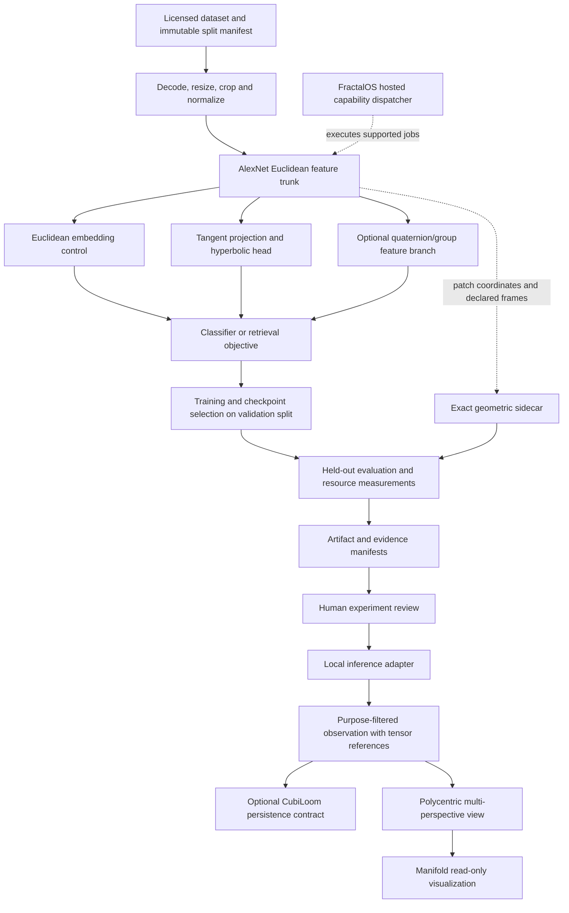

# Proposed GET–AlexNet implementation framework

## 1. Objective and status

Build an experimental visual encoder that asks whether hyperbolic embeddings,
discrete geometric metadata and structured temporal memory improve selected
vision tasks over a controlled AlexNet reference. Start with classification and
hierarchical retrieval. Treat video, multi-agent geometry and reconstruction as
separate later tasks with their own data and metrics.

The deliverable is initially a **visual encoder**, not a foundation model. That
term requires substantially broader pretraining, transfer evaluation and scale.
Neither the research papers nor geometric compatibility establishes improved
accuracy, compression, energy use or runtime; each is an experimental hypothesis.

Implemented today: existing exact geometry, codecs, verification and ecosystem
reference harness. This directory adds only a validated **planning scaffold**.
All model/training/storage/backend components below are proposed until their
own tests and execution evidence exist.

Working name: `GET–AlexNet Experimental`; model IDs below are experiment IDs,
not new SHD-CCP Form IDs. No changes to existing protocol fields or vectors.

## 2. Three computational planes

| Plane | Representation | Operations | Authority |
|---|---|---|---|
| Learned vision | float32 first; float64 numerical oracle | convolutions, normalization, gradients, projection, hyperbolic distances | predicts features/labels with measured uncertainty |
| Exact geometry | doubled Hurwitz integers; integer lattice addresses and quadrances | norm, multiplication, Gram-TQF, S5 paths, discrete schedules, ordered reductions | checks precisely stated discrete relationships |
| Provenance/control | versioned manifests, hashes, policies, clocks, frame metadata | artifact linking, permitted publishing, replay handling, backend dispatch | accepts data only under independently defined identity/policy controls |

An image pixel lattice, feature-map lattice, learned latent manifold and physical
3D scene are **different spaces**. Every transform declares which two spaces it
connects. A class embedding is not a calibrated physical position; a learned
quaternion is not automatically a valid Hurwitz quaternion. Casting floats to
integers is a quantization step with an error budget, not proof of exactness.

Never insert a rounding-to-Hurwitz operation into backpropagation implicitly.
Any later straight-through estimator must be a separately named, biased-gradient
experiment, with numerical controls and measured quantization distortion.

## 3. End-to-end flow



Training normally stays local. The observation route does not send raw images,
private embeddings or weights unless the operator grants that specific export.
Unavailable CubiLoom is not silently replaced by a claimed durable database.

## 4. Repositories and component ownership

| Owner | Implementation responsibility | Geometric-Labs contribution |
|---|---|---|
| Geometric-Labs | initially standalone experimental training package and evaluation harness | model hypotheses, configs, baselines, acceptance reports, source provenance |
| SHD-CCP-core | fixed Tile codec/exact reusable geometry | import existing APIs; propose any missing generic API through an upstream PR |
| Kernel-Registry | reviewed operator/profile metadata | submit candidate evidence, never auto-certify model claims |
| PolyShard-Agent | local image/model custody and observation adapter | test opt-in inference without private RAG/image leakage |
| CubiLoom | persistent events, artifact references, replay and replication | contract tests only until actual upstream implementation exists |
| Polycentric-Orchestrator | policy/admission and derived multi-agent scene | distinguish feature observations from spatial measurements |
| Manifold-Projection | read-only scene/latent projections | CPU visualization baseline with explicit approximate display status |
| FractalOS-runtime | typed hosted compute ABI and capability selection | adapter proposal; no claim its current C header runs neural inference |

Keep model code local to the experimental package until ownership is reviewed.
Do not distribute pieces of one trainer across seven repositories. Promote only
stable shared interfaces later; dependency repositories remain independent clones.

## 5. Controlled AlexNet starting point

Use a precise **torchvision-style AlexNet**, not an undefined mixture of the 2012
model, grouped convolutions and modern variants. Initial reference architecture:

| Stage | Operation | Output for N×3×224×224 input |
|---|---|---|
| 1 | Conv 3→64, kernel11, stride4, padding2; ReLU | N×64×55×55 |
| 2 | MaxPool kernel3, stride2 | N×64×27×27 |
| 3 | Conv 64→192, kernel5, padding2; ReLU; MaxPool3/2 | N×192×13×13 |
| 4 | Conv 192→384, kernel3, padding1; ReLU | N×384×13×13 |
| 5 | Conv 384→256, kernel3, padding1; ReLU | N×256×13×13 |
| 6 | Conv 256→256, kernel3, padding1; ReLU; MaxPool3/2 | N×256×6×6 |
| 7 | AdaptiveAvgPool 6×6; flatten | N×9216 |
| 8 | Dropout .5; Linear9216→4096; ReLU | N×4096 |
| 9 | Dropout .5; Linear4096→4096; ReLU | N×4096 |
| 10 | Linear4096→K | N×K logits |

This variant has no original AlexNet LRN, grouped convolution or two-GPU split.
Record that difference in every report. Test all shapes and parameter counts
against an independently instantiated pinned torchvision model. Fix preprocessing,
initialization and training recipe per comparison. Primary causal comparison uses
random initialization; optional pretrained track uses one declared weight digest,
its exact transforms and documented training-set overlap for all compared heads.

Low-resolution datasets must have an explicit policy: resize to this 224px model,
or create a separately named small-image architecture applied to all variants.
Do not compare one variant with a modified stem and call the gain hyperbolic.

## 6. Model family and ablations

| ID | Change from control | Purpose |
|---|---|---|
| E0 | full torchvision-style AlexNet above | reference classification baseline |
| E1 | same trunk → pool → matched d-dimensional Euclidean projection and classifier | primary architecture-matched embedding control |
| H1 | replace E1 geometry with fixed-curvature Poincaré embedding | isolate hyperbolic metric/head |
| H2 | H1 plus trainable bounded curvature | test curvature learning separately |
| Q1 | E1 plus quaternion/group feature block, no hyperbolic head | isolate quaternion parameter sharing |
| QH1 | combine selected Q1 and H1 only after isolated tests | interaction ablation |
| T1 | selected encoder plus retained temporal quaternion sidecar | temporal experiment on video, not image baseline |
| X1 | quantized/tiled feature export after selected encoder | transport distortion/size experiment |

For E1 use global average pooling of the 256-channel trunk output, then a
Linear256→d projection and K learned d-dimensional prototypes; classify with
negative squared Euclidean prototype distances, the same fixed temperature and
class biases used by H1. This removes a linear-classifier-vs-prototype-head
confound while keeping E0 as the historical classifier reference.

Use d=128 as an initial hypothesis, not a justified optimum; sweep declared
values using only validation data. Pair E1 and H1 projection architecture,
parameter budget, optimization budget, augmentation and training examples.
Report E0 as context because replacing its large FC classifier changes capacity.
Use at least three matched random seeds for comparison; expand if uncertainty
obscures the proposed decision threshold. Report every run, not the best seed.

## 7. Hyperbolic head and numerical contract

Use one explicitly defined Poincaré ball convention for negative curvature -c,
c>0, ball B_c={x : c||x||²<1}. Initial c=1.0.
For tangent vector v at the origin define

`exp0_c(v) = tanh(sqrt(c)*||v||) * v / (sqrt(c)*||v||)`.

Its v→0 limit is v. With this convention the metric conformal factor at the
origin is 2; do not mix formulas from another tangent-scaling convention.

Distance:

`d_c(x,y) = acosh(1 + 2*c*||x-y||² /
                    ((1-c*||x||²)*(1-c*||y||²))) / sqrt(c)`.

Use tested stable forms (`asinh`/`log1p` identities where appropriate), safe norms,
and special handling at coincident points. Compute a float64 oracle and check
finite outputs and gradients in float32. Guard rather than silently accept NaN,
Inf, invalid curvature, or outside-ball coordinates. Log clamp/projection rates.
Project to radius `(1-epsilon)/sqrt(c)` only under a recorded numerical policy;
this projection is approximate and affects gradients near the boundary.

Starter head: Euclidean projection v=W h+b → exp0_c(v); K class prototypes
mu_j=exp0_c(a_j), where a_j are unconstrained tangent parameters; logits
`-d_c(z,mu_j)^2 / temperature + class_bias_j`.
Use ordinary Adam/SGD for these tangent parameters. **Do not claim Riemannian
optimization** when all learned parameters are Euclidean tangent variables.
A later directly manifold-valued optimizer requires tested retractions,
Riemannian gradients and parallel transport, as a separate experiment.

H2 parameterizes c in a bounded positive interval, initially [1e-3,10], via a
smooth map; test saturation and sensitivity. Make temperature fixed in H1 and
report its identifiability interaction with curvature if later learned.

Start with cross-entropy. Optional hierarchy loss:
`L = L_class + lambda_h * L_declared_hierarchy + lambda_r * L_boundary`.
Each nonzero weight is a separate ablation. Hierarchy edges come only from the
training ontology; label leakage through test taxonomy/labels is prohibited.
Boundary regularization records both its formula and effect. It is not evidence
that any biological/physical hierarchy has been discovered.

## 8. Geometric Engine adapters: scope of each feature

| Element | Proposed use | Boundary / falsification |
|---|---|---|
| Origin-centered cubes K/V/W | optional feature/patch LOD address bounds [-1,1],[-2,2],[-4,4] in a declared coordinate convention | address hierarchy does not make a 2D image physically 3D |
| S5 hyperbolic tree | discrete research indexing of declared hierarchical patch/cluster IDs | distinct from continuous Poincaré embeddings; no invented canonical map between them |
| Hurwitz units | exact discrete orientation tags or candidate group-equivariant filters | 24 Hurwitz units are binary tetrahedral, not all 24 cube rotations |
| Quaternion feature layers | four-channel groups with explicit Hamilton-product weight sharing | feature channels need a declared convention; ordinary RGB is not automatically a quaternion orientation |
| Gram-TQF | exact check on integer patch/scene correspondences | arbitrary embeddings are floats; physical frame registration is a prerequisite for scene comparisons |
| 8-step engine cycle | scheduler index `k=t mod 8` | eight stages do not imply eight neural layers or a new physical clock |
| 24-step supercycle | optional joint modulo-8/modulo-3 task schedule | measure overhead; no assumed free throughput gain |
| 64-stream balancer | synthetic discrete routing/closure experiment | not 64 feature channels, OS threads or automatic GPU occupancy |
| 12-engine parity | one-erasure recovery of specified quaternion group aggregates | not recovery of image/weight tensors or arbitrary lost histories |
| 720→72→10 memory fold | preserve ordered aggregate holonomy; retain deltas/residuals for exact replay | SLERP lift is interpolated motion, not original-frame reconstruction |
| Acoustic cubit | optional physical sensor calibration metadata | not required for image classification or a universal pixel-to-meter conversion |
| Prime/CRT tools | exact indexing/certification where explicitly justified | no claim of improved neural optimization or cryptographic identity |

For Q1 choose either RGB→learned 4-channel lift or purely latent four-channel
groups; name the choice. Test Hamilton multiplication signs, parameter sharing
and gradients. A real 2D image rotation requires actual image transformation and
an explicitly constructed equivariance action. Quaternion multiplication alone
does not prove equivariance. Keep a capacity-matched ordinary convolution control.

## 9. Optional temporal lane

Use video frames with calibrated/published timestamps and a leakage-safe
sequence/subject split. Image classification labels are not temporal evidence.
Predicted continuous orientation is initially numerical S3 state. Keep it
separate from exact discrete Hurwitz-unit test sequences; do not quantize it and
call the original motion exact.

For exact reference sequence q_n with open boundary q_-1=q_0:
`Delta_n=q_n*inverse(q_(n-1))`, outer product `Delta_last*...*Delta_0`.
Retain established right-acting inverse-middle chronological order and the uneven
72→10 partition. Do not alter the already tested holonomy convention.

Store source states/fine deltas and metadata if replay is required. Evaluate
three storage modes: full reference, aggregate+retained residuals, and aggregate+
SLERP approximation. Count model, decoder, indexes, residuals and sidecars in
storage bytes. Measure frame/trajectory error and failed recoveries explicitly.
Retained history is local until export policy allows it.

## 10. Data, preprocessing and split contracts

Begin with a small synthetic shape dataset for wiring; its results are only a
smoke test. For meaningful classification pick a licensed dataset (e.g. an
operator-provided CIFAR-10 copy with the explicit 224px policy). Downloading and
redistributing datasets/weights are separate actions; nothing downloads by default.
Hierarchy experiments need a real, versioned class hierarchy (e.g. a licensed
CIFAR-100 fine/coarse task) rather than an invented hierarchy over arbitrary labels.

`DatasetManifest`: schema ID, dataset/version/license/source, split hashes,
class map digest, hierarchy digest if used, subject/video/group partition rule,
preprocessing digest, sample counts and allowed purposes. Split *before*
augmentation. Keep train/validation/test disjoint at source identity, not just
filename. No normalization statistics, feature fitting or hyperparameter selection
on the test split. Fix seeds for data order and augmentation per matched run.

Train transform: declared resize/crop policy, horizontal flip if task-valid,
tensor conversion and declared channel normalization. Eval: deterministic
resize/center crop and same statistics. Document that ImageNet normalization is
a modeling choice when data are not ImageNet. Preserve aspect-ratio policy.

## 11. Tensor and observation contracts

| Record | Required contents |
|---|---|
| TensorArtifact v1 | blob hash, hash algorithm, dtype, endian, shape, strides/layout, size, artifact URI, encoder/checkpoint digest, privacy/purpose |
| FeatureObservation v1 | sample ref, model/config digest, feature artifact ref, representation (`euclidean`, `poincare`, `quaternion`), c/convention if applicable, numeric error policy, source agent |
| GeometrySidecar v1 | coordinate space/frame ID, unit/scale/origin, integer lattice coords or explicitly approximate transform, uncertainty/calibration refs, source refs |
| ClockContext v1 | domain/epoch, monotonic index, timestamp if present, uncertainty, sequence; engine phase separate from elapsed time |
| RunManifest v1 | Git SHAs/lock, dependency lock digest, dataset/split hashes, seed, transforms, model, optimizer, precision, platform and checkpoint digests |
| EvaluationReport v1 | task/split digest, all metrics and seed intervals, resource measurement protocol, failures/skips, comparison budget and selection rule |

A Tile carries 64 bits, not an arbitrary embedding. For v1 export prefer tensor
artifact references in a versioned sidecar and use existing supported raw scalar
Form 3 only where appropriate. Transmitting a d=128 float32 vector as scalar Tiles
alone costs at least 128×8=1024 bytes, versus 512 raw tensor bytes, before envelope
metadata. Report this overhead rather than promising 64-bit feature compression.
No new Form IDs or speculative residual flags are assigned in this proposal.

Content hashes locate/check bytes; they are not signatures. In deployment, bind
manifest and blob digests with authenticated identities and purpose/consent,
expiry, sequence/nonce and durable replay state. The existing localhost HMAC
demo is a development reference, not that completed production contract.

## 12. Training system and reproducibility

Implement training as a separate optional Python environment. Keep the current
stdlib math package dependency-free. Proposed dependencies: a pinned compatible
PyTorch/torchvision pair, a reviewed config/schema parser if needed, and optional
metric tooling. Produce explicit CPU and CUDA lockfiles; do not write fictitious
version pins or an untested cross-platform lock now. Use wheel hashes and retain
TLS verification. Choose exact versions during the first environment PR and
record successful import/forward/backward tests.

Initial numerical lane: CPU smoke → float32 accelerator training if available.
Use float64 for small geometry/gradient oracles. Disable AMP until H1 numerical
checks pass. Later permit AMP only for tested Euclidean convolutions, keeping
manifold distances/reductions float32/64 as specified. Log TF32 and deterministic
kernel policies. A seed alone does not ensure cross-device bitwise reproducibility.

Trainer responsibilities: deterministic split loading, worker seeding, config
validation, forward/backward, finite-gradient checks, optimizer and LR scheduler,
validation, checkpoint and RNG-state save, resumable data position, artifact
hashing and failure reports. Validate interrupted/resumed training against an
uninterrupted run under the same deterministic platform. Serialize only tensors
and approved metadata; do not execute arbitrary pickle/checkpoint code from an
untrusted source. Optimizer-state restoration has its own trusted-artifact policy.

Select checkpoint using a predeclared validation criterion. Evaluate the held-out
test set once after selection. Support incomplete runs explicitly; do not drop
diverged H1 seeds from the comparison. Sweep budgets and early-stop rules must
match the Euclidean control. No invented epoch counts, accuracy targets or compute
cost claims are presented as observed results.

## 13. Evaluation and decision rules

| Question | Metrics and controls |
|---|---|
| Classification useful? | top-1, macro F1, class-balanced metrics where needed; loss; calibration (ECE with bin spec, NLL) |
| Hierarchy useful? | hierarchical error/distance using declared taxonomy; same Euclidean head/hierarchy supervision control |
| Retrieval useful? | Recall@k/mAP with disjoint query/gallery policy and task-appropriate ground truth |
| Geometry stable? | finite gradients, oracle distance error, ball-bound violation/projection rate, curvature/temperature history |
| Quaternion layer helpful? | matched parameter/compute control, real transform-equivariance error, task metric |
| Robustness improved? | fixed corruption/rotation suite, same augmentations and severity; clean and shifted metrics |
| Faster/cheaper? | parameters, MACs with convention, peak memory, end-to-end throughput, batch-1 p50/p95 latency |
| Compression useful? | total transmitted/stored bytes including sidecars/model amortization, task degradation, reconstruction error |
| Temporal lane useful? | rotation geodesic error, trajectory error, state replay exactness for exact mode, residual bytes |

Synchronize GPU timing, warm up, report batch/resolution/device/runtime, include
preprocessing and IO in end-to-end numbers, separate training from inference.
Measure CPU/GPU energy only with an available named meter/profiler and stated
sampling/boundary; no estimate relabeled a hardware measurement.

Proposed go/no-go rule: pre-register a primary task/metric and practical effect
margin after a pilot (before looking at held-out test outcomes); compare paired
seed results, interval of the difference and resource costs. Allow superiority
or declared noninferiority+cost improvement. If results are inconclusive, retain
E1 and label H1 unproven; do not ship a geometric head solely on nomenclature.

## 14. Proposed source layout and ownership boundaries

The actual planning files already exist beside this document. **The tree below
is future implementation scaffolding, not a list of implemented modules.**

```text
ecosystem/experiments/alexnet_get/
  README.md, configs/, contracts/, tools/plan.py, docs/   # planning scaffold now
  pyproject.toml                         # optional ML package; separate dependencies
  locks/{cpu,cuda}.requirements.lock     # create only after actual compatibility tests
  src/get_alexnet/
    data/{manifest,splits,transforms,loaders}.py
    models/{alexnet_reference,euclidean_head,hyperbolic_head,quaternion_block}.py
    geometry/{poincare,quantization,exact_bridge,orientation_actions}.py
    temporal/{state_sequence,ordered_fold,residual_store,interpolation}.py
    training/{trainer,losses,optimizers,checkpoint,reproducibility}.py
    evaluation/{classification,retrieval,hierarchy,robustness,resources,compression}.py
    artifacts/{tensor_store,run_manifest,reports}.py
    adapters/{polyshard,orchestrator,cubiloom,projection,fractalos}.py
    runtime/{capabilities,cpu,pytorch_device}.py
    cli.py
  tests/{unit,numerical,integration,security}/
  scripts/{train,evaluate,benchmark,export}.py
  artifacts/, datasets/                 # ignored, policy-controlled; never commit private data
```

See `contracts/scaffold.v1.json` for per-area inputs, outputs, acceptance tests
and implementation order. Actual upstream adapters call independently versioned
APIs; no product code is vendored here. Root Makefile and existing CI stay intact;
a future dedicated ML workflow gets time/resource limits and optional GPU jobs.

## 15. Instructions by implementation stage

**P0 — environment and contracts.** Create optional package/environment, resolve
and pin CPU dependencies, implement manifests and split validation. Use synthetic
fixtures to test artifacts/policy without downloads. Exit: import and tensor-shape
smoke, contract negative tests, existing math/ecosystem suites still pass. No
hyperbolic optimization or distributed integration yet.

**P1 — E0/E1.** Implement exact declared AlexNet topology, independent torchvision
comparison, Euclidean embedding head, trainer and checkpoint resume. Exit: forward,
backward, tiny-batch overfit, deterministic same-platform resume, and real pilot
baseline with all data/compute provenance. Failure blocks H1 comparison.

**P2 — H1/H2.** Implement float64 distance/exp-map oracles, gradients (including
zero/coincident points), fixed-curvature prototype head then bounded c learning.
Exit: numerical tests, finite runs and matched E1 evaluation. Keep H2 separate.

**P3 — exact sidecars and optional Q1.** Reuse tested exact primitives; define
coordinate mappings and uncertainty; implement quaternion blocks with gradient
and group-action tests. Exit: no unmarked quantization or false equivariance;
semantic-profile mismatch rejects; compare Q1 separately before QH1.

**P4 — temporal and export.** Use a video dataset with valid splits; test ordered
holonomy against retained history, then labeled approximation. Measure transport
and reconstruction costs. Exit: exact-vs-approx status, missing residual failures,
source refs preserved. A selected static image model does not imply T1 passed.

**P5 — ecosystem adapters.** Implement local PolyShard inference, purpose-filtered
FeatureObservation, orchestrator admission and read-only projection. Integrate
CubiLoom only when append/replay upstream exists. Exit: wrong profile, denied
purpose, duplicate/replay, clock/frame uncertainty and offline behavior tested;
never claim expired-frame rejection before certificates support expiry.

**P6 — FractalOS hosted job lane.** Extend current draft ABI in its owning repo
for tensor handles, dtype/layout, error statuses, cancellation, buffer lifetime,
device capability and precision requirements. Its existing Tile-only job header
is insufficient for neural training. Begin with hosted CPU inference; compare
same checkpoint/output tolerances before any optimized GPU implementation.

**P7 — accelerator/research lane.** Only after profiling identifies a bottleneck,
consider CUDA SM90 tiling/TMA/DSMEM; test memory alignment, producer/consumer
barriers and cluster scope. H100 unavailable means skipped. Loihi 2 requires a
separate event/SNN model, conversion/training/calibration and measured accuracy/
latency/energy; no direct AlexNet or Tile execution claim. QEMU boot is an OS
project independent of successful hosted neural inference.

Each stage gets a branch/PR, changed-contract list, evidence and rollback recipe.
Do not compress all stages into one unreviewable commit or auto-promote kernels.

## 16. Test and failure matrix

| Layer | Positive acceptance | Negative/failure behavior |
|---|---|---|
| Data | stable split and preprocessing hashes | overlap, changed label map, invalid license metadata fail |
| Reference model | shapes/parameter count and independent outputs | wrong channel/image sizes fail with diagnostics |
| Numerical geometry | exp/log round trip, symmetric distance, d(x,x)=0, finite gradients | invalid c, nonfinite vectors, outside-ball values, curvature saturation recorded |
| Exact bridge | preserved integer fixtures, parity, frame convention | overflow, invalid parity, undeclared quantization/frame fail |
| Trainer | tiny batch learning, save/resume equivalence | nonfinite loss/gradients stop with recoverable report |
| Artifacts | digest, dtype/layout/shape and size agree | altered tensor, untrusted serialization and missing dependencies reject |
| Transport/policy | declared profile and authorized metadata admitted | wrong version, unsupported form, denied export, replay reject |
| Temporal | exact retained sequence replay | coarse-only history cannot masquerade as exact recovery |
| Backend | output tolerance, capabilities, lifetime and cancellation | missing GPU/unsupported precision fail or explicitly requested fallback |
| Evaluation | matched seeds/budgets and test separation | unavailable hardware, missing runs, leaked split marked blocked/invalid |

Proposed initial numerical tolerances are decided per dtype/domain in the
numerical PR, based on oracle-error distributions and task sensitivity, not a
universal 1e-6 promise for arbitrarily near-boundary hyperbolic points.

## 17. Security, operations and rollback

Keep data local; log digests and metrics rather than private samples. Separate
telemetry display from authority. Bound image sizes, batch/token payloads and
artifact allocation before decode to avoid decompression/resource attacks.
Use explicit access control for artifact retrieval; knowledge of a hash grants
no permission. Set training budget, checkpoint retention, cancellation and job
ownership. Redact experiment manifests if public paths reveal private identities.

Maintain separate mathematical, implementation, security and deployment statuses.
Roll back by restoring reviewed model/config/environment/adapter versions; never
rewrite source observations or original vectors to fit a preferred model outcome.
A model rollout, if later authorized, can shadow-test locally before serving;
this proposal deploys nothing and accesses no production infrastructure.

## 18. First concrete work order

1. Review the source/decision ledger and choose the initial licensed dataset.
2. Implement P0/P1 only: optional CPU ML environment, manifests, E0/E1, trainer,
   numerical-free smoke tests and resumable pilot.
3. Freeze the comparison recipe and pilot evidence before introducing H1.
4. Implement P2 as an independent model-head PR with explicit oracle tests.
5. Advance optional geometry/temporal/integration lanes only on their own evidence.

The architecture is usable now as a development plan. No benchmark, trained
checkpoint, production cryptography, foundation-model capability, hyperbolic
performance advantage or accelerated runtime is claimed by this scaffold.
