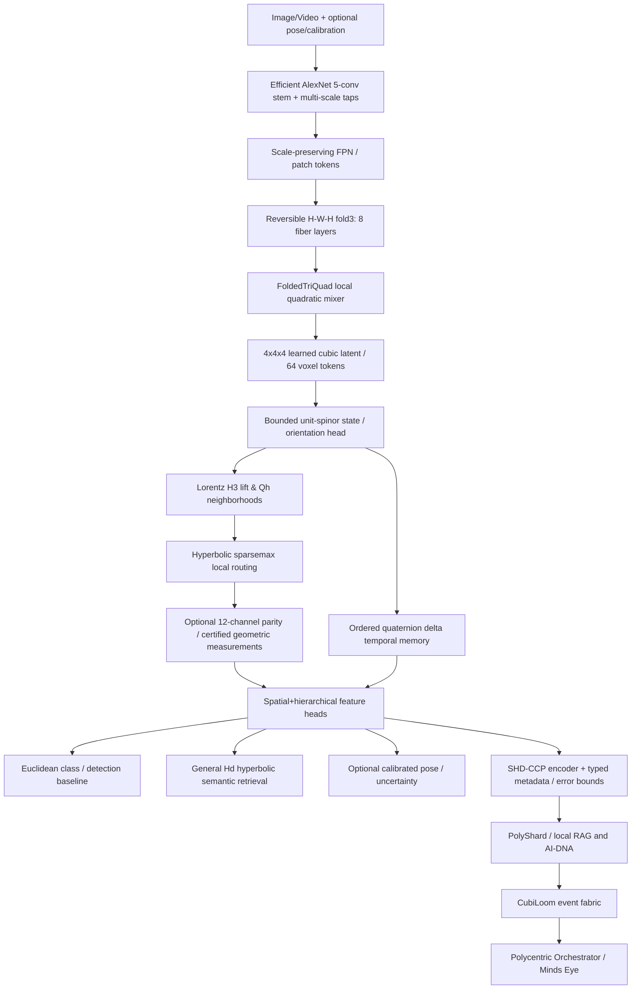

# BioChain AI — AlexNet-H/GEOT: Geometric Engine of Time Visual Foundation

**Research design RFC 0.2 · 25 October 2026**  
**Status:** proposed architecture and independently executable math primitives; not a trained visual network or a demonstrated speedup.

## 0. Decision

**A major restructuring is feasible and research-worthy.** The strongest route is to preserve an efficient Euclidean convolutional stem, retain patch/scale geometry, add a reversible eight-fiber folding operation, map **bounded quaternion spinor state** to a Lorentz `H^3` subspace for **sparse 64-voxel neighborhood routing**, and introduce **ordered temporal quaternion deltas** only when consecutive visual frames or orientation measurements exist. Keep a general learnable hyperbolic semantic embedding branch; a 4D spinor lift cannot substitute for a 64D Poincaré image embedding. Never treat structural, geometric, or semantic agreement as cryptographic authentication.

For this RFC, **GEOT** = research mapping of the *Geometric Engine of Time* into trainable visual processing. It is not a physics claim.

## 1. Reviewed source corpus (all 13 supplied documents)

| # | Document | Source-derived construction | How it informs GEOT | Important scope |
|---|---|---|---|---|
| 1 | *Quaternionic Delta Encoding on Golden Strassen-Clifford Toroids* (6 pp) | Golden ratio radii, quaternion deltas, claimed prime-resonance and Strassen-like processing | Optional 2-angle torus codebook and ordered orientation-delta prior | Later QCC and sieve papers explicitly revise torus closure, drift, prime certainty and Strassen claims |
| 2 | *Introduction to 4D Coordinate Geometry for the Golden Strassen Clifford Toroid* (4 pp) | Torus `S¹(r1) × S¹(r2) ⊂ S³ ⊂ R⁴`, `r1/r2 = φ` | A constrained 2D latent factor, ablated against unrestricted `S³` | Radius ratio does not fix frequency ratio; an irrational frequency ratio, not golden radii alone, gives dense linear flow |
| 3 | *Extending the Framework: Triple-Quad Function on a 3-Folded Packet* (12 pp) | Three binary folds give eight layers and planar area 1/8; overlapping four-site quadratic functionals; projective fibers; persistent homology | Reversible `fold3` space-to-depth permutation; local multi-fiber quadratic measurements; optional topology regularization | Its triple-of-four-site function is not the triangle-area Triple Quad Formula; `n³` counts require `n` depth samples, not free reconstruction |
| 4 | *Mathematical Model for the Torsional Markov Memory-Offload Pump* (7 pp) | 720→72→10, inverse mid-tier, ordered products, Markov circulation, holonomy closure | Temporal/keyframe aggregation with explicit ordering, residuals and reconstruction flags | Coarse block products do not preserve arbitrary per-frame history |
| 5 | *The Hyperbolic Sparsemax Pump* (10 pp) | `V=(Z/4Z)^3`, 64 voxels, positive-scalar rational `S³` spinors, Lorentz lift, `Qh=sinh²d`, sparsemax and rational directed valve | The strongest concrete research module: local, sparse, hyperbolic neighborhood routing | Exact rational conclusions require *rational unit inputs and rational coefficients*; ordinary float-trained heads do not satisfy them automatically |
| 6 | *zero point 8 part cycle* (3 pp, image pages) | Eight-step `π/4` conceptual schedule, expansion and inward folding, `4π` spinor cycle | Optional eight-stage recurrent scheduling vocabulary | No proof that eight stages improve recognition, or that physical time/CPU is eliminated |
| 7 | *Quaternion Chain Compression: Definitions, Proofs, and System Interfaces* (15 pp, image pages) | Form-0 state/delta semantics, bounded-error state words, keyframe/delta coding, block access, explicit limitations | Reference codec design and exact-vs-lossy storage/reconstruction contracts | Corrects older papers: no generic compression; golden torus is not all of `S³`, no float-drift elimination or Strassen claim; experimental bounds apply to specified synthetic streams |
| 8 | *The Geometric Engine of Unified Report of Hierarchical Chronometry* (19 pp) | All supplied pages visually empty apart from timestamp/link furniture | None: cannot substantively analyze text | Treat as unavailable content; do not infer conclusions from title |
| 9 | *Geometric Engine of Time: Fokker–Planck Prime Sieve in Quaternionic Lattices* (38 pp) | Prime-trap Markov master equation; geometry proposes, arithmetic certifies; exact lattice invariants and Einstein Tile | Exact integer TQF/oracle and metadata certification; optional prime-coded research experiments | Explicitly says sieve does not compute primes; Golden Clifford torus has **no exact lattice point**; non-local alignment means coordinate-independent invariant matching, not instantaneous messaging |
| 10 | *The Fifteen Lemmas of the Geometric Engine* (39 pp, image pages) | Four-layer mathematical-to-physical hierarchy, fixed tile bit layout, 8-step cycles, 12-channel structure, 4×4×4 lattice and exact geometric references | Ontological organization, certified geometric reference tests, sidecar status tags | Some correspondences are counted patterns, not structural theorems; engineering performance requires separate evidence |
| 11 | *shd-ccp sumption cycle* (2 pp, image pages) | Micro/meso/macro tri-perspective stages, visualized 4×4×4 lattice and residual/skew | Cross-perspective aggregation and residual monitoring | GPU projection is not O(1) for arbitrarily many vertices; phase cancellation cannot establish authenticity or truth |
| 12 | *Memory in the Twelve-Engine Hierarchy* (8 pp) | Three groups of 3+1 ordered holonomy closure; 9 payload engines + 3 parity engines, 720/72 correspondences | Optional three-view/12-channel parity-and-failure-tolerance experiment | One erasure **of a group holonomy** per group, not the lost original images/deltas; 25% capacity cost; counts alone imply no compression |
| 13 | *The Torsional Markov Memory-Offload Pump* (9 pp) | Formalized ordered telescoping; 720→72→10 variable 7/8-frame partition, interpolation, single Markov cycle current | Temporal-memory design with exact aggregate products and approximate full reconstruction | Fractional-power lift reproduces the coarse aggregate, not the original fine-grain motion unless additional residuals are stored |

**Precedence for implementation:** recent QCC limitations and the formal Fokker–Planck paper supersede older absolute claims when they conflict. Treat the mathematical assumptions in each paper literally.

## 2. Mathematical/engineering reconciliation

### 2.1 Golden Clifford torus is a useful constrained *submanifold*, not the entire rotation space

Set `φ=(1+sqrt(5))/2`, `r1=φ/sqrt(1+φ²)`, `r2=1/sqrt(1+φ²)` and

`q(θ,ψ)=(r1 cos θ, r1 sin θ, r2 cos ψ, r2 sin ψ) ∈ S³`.

This is a 2-dimensional torus inside the 3-dimensional sphere `S³`. An arbitrary unit quaternion has three degrees of freedom and generally cannot be represented on that torus; quaternion multiplication does **not** preserve this fixed torus. It can be used as a low-dimensional, information-losing regularized codebook, not a universal exact embedding. Irrational winding requires irrational *angular frequency ratio*; radii alone do not establish this. Use it only behind an ablation flag.

### 2.2 Hyperbolic sparsemax has an implementable mathematical core

Source's rational quaternion-lift assumptions (Section 2–7): unit `q_i=(w_i,m_i)∈S³∩Q⁴` with `0 < wmin ≤ w_i ≤ wmax < 1`.

`X_i=Φ(q_i)=(1/w_i,m_i/w_i) ∈ H³`, with Minkowski product `<X,X>_L=X0²−X1²−X2²−X3²=1`.

`Qh(i,j) = <X_i,X_j>_L² − 1 = sinh²(d_H(X_i,X_j)) ≥ 0`.

`z_ij = −β_i Qh(i,j) − λ A_ij`, `β_i=(1−w_i)/w_i`.

`sparsemax(z)_j = max(z_j−τ,0)`, with `τ` chosen for the simplex sum to equal 1.

This defines a real candidate visual routing module on local graph edges. It is **not** a triangle-inequality metric: `sinh²(d)` is distance-monotone but generally violates the triangle inequality. Floating point training is not rational-exact inference; implement a separate checked, fixed-point or Fraction rational reference, including bounds for numerator/denominator growth and overflow. The self-loop is always maximally scored under the stated sign assumptions, so all-self-loop routing collapse must be tested.

### 2.3 Two different triple-quad objects must have different APIs

1. **`TriangleTQF`**: for Euclidean lattice points `p1,p2,p3`, use three squared distances `a,b,c`; return `16*A² = 4ab−(a+b−c)²`. This is an exact integer invariant on bounded input coordinates; does not prove a common frame exists and does not uniquely orient a triangle.
2. **`FoldedTriQuad`**: the 3-folded paper's `Q_A(x)+Q_B(x)+Q_C(x)`, where each `Q` is an overlapping *quadratic functional of four folded feature values*. It is a learned/local energy statistic. It is not equivalent to `TriangleTQF` without separately supplied construction and proof.

### 2.4 Temporal quaternion delta compression is conditioned on actual temporal data

Choose scalar-first Hamilton multiplication and left-acting deltas `Δq_t=q_t q_(t−1)^−1`. For each block `[a..b]`, `ΔQ=Δq_b⋯Δq_a=q_b q_(a−1)^−1`. The 720→72 mapping packs 10 ordered increments per block. The 72→10 blocks have sizes `[8,7,7,7,7,8,7,7,7,7]`. The three-scale pump is **not** a lossless codec for arbitrary frame-by-frame motion: retain fine deltas/residuals to reconstruct fine trajectories. Closed loops may be checked for holonomy; do not force an arbitrary open motion clip to identity.

### 2.5 12 channels / 64 voxels / eight geometric steps

- 12-channel optional geometry prior: three groups of `3 data + 1 closure` holonomies with ordered multiplication, **not** equivalent to 12 independent views or recoverable full image data.
- 64 voxel lattice `V=(Z/4Z)^3` is suitable as a *small learned latent graph* (`4×4×4`) for neighborhood routing. Without calibrated multi-view input, it is a latent cube rather than reconstructed physical 3D reality.
- Eight geometric phases can parameterize a recurrent block or scheduling trace (`seed/onload/halfcube/apex/infold/offload/vandermonde/snap`), but neither the `STEP` register nor a spinor's `4π` periodicity imposes eight neural layers or 720 frame evaluations.

## 3. Proposed complete model: AlexNet-H/GEOT v0.2

### 3.1 Concrete tensor contracts

| Operation | Shape / constraints | Engineering note |
|---|---|---|
| Input | `B×3×224×224`, or `B×T×3×H×W` | Standard normalization and true source time metadata |
| Conv backbone | multi-scale taps e.g. `B×192×27×27`, `B×384×13×13`, `B×256×13×13` (224 AlexNet) | Reuse current v0.1 first; benchmark depthwise replacement later |
| Align and reduce | spatial resize / reference frame + `1×1` projected channels `B×C×16×16` | Projection is lossy; retain feature map path for tasks requiring detail |
| `fold3` H/W/H | `B×8C×4×8` | Exact permutation of the *already selected tensor*; no inherent data compression |
| Folded quad mixer | input folded fibers 8, local four-site overlaps | Distinct API from triangle TQF; define and learn coefficients explicitly |
| Cubic graph | `B×64×D`, voxel ids `(x,y,z)∈{0,1,2,3}³` | Learned latent grid, not measured depth without sensor supervision |
| Per-cell spinors | `B×64×4` bounded `q∈S³` | `w>0` annulus only for rational Lorentz lift branch; positive sign loses some orientation coverage |
| Hyperboloid | `B×64×4` in `H³` with Minkowski norm +1 | Float differentiable training; separate exact rational test oracle |
| Sparse edges | each cell self+up to face neighbors / 12 torsional channel labels | Sparsemax row over candidate edges, not full 4096 dense pair matrix |
| Semantic head | e.g. `B×64` Poincaré embedding retained from v0.1 | General H^64 semantics **different from H³** geometry routing |
| Temporal chain | `B×T×4` orientation changes, optional 720→72→10 | Use on video/pose streams only; include masks and residuals |
| Output packet | canonical Einstein Tile `uint64` + authenticated metadata | Encoding must specify semantic profile, quantization, frame/clock, codec/codebook digest |

**Architecture budget:** keep the prior 2,486,913-parameter model as a fixed baseline. Target `2.5–5M` parameters for the next experiment only as a **design constraint**; actual parameter count, FLOPs, activation RAM, accuracy and latency must be measured. Channel ×8 after folding can INCREASE compute if fed into an uncompressed convolution.

### 3.2 Geometric processing phases (proposed scheduling correspondence)

| Step bits `[63:61]` | Glossary phase | Proposed vision operation | Proof of benefit? |
|---|---|---|---|
| `0` | SEED | Ingest calibrated input, initialize frame/clock metadata | No |
| `1` | ONLOAD | Convolutions, spatial feature ingestion | No |
| `2` | HALFCUBE | Binary three-fold rearrangement and 64-cell assembly | Shape exactness test only |
| `3` | APEX_DILATE | Geometric lift and normalized quaternion/pose state | Norm/invariant test only |
| `4` | INFOLD | Sparse hyperbolic neighborhood aggregation | Ablation needed |
| `5` | OFFLOAD | Temporal block consolidation, residual/keyframe handling | Aggregate identity test only |
| `6` | VANDERMONDE | Cross-perspective alignment with valid calibration and uncertainties | Actual alignment required |
| `7` | SNAP | Materialize outputs, encode SHD-CCP + sidecars, commit event | Packet tests only |

This is a **software design mapping**, not a new deduction from the eight-step mathematics and not a global physical clock.

## 4. Training objectives and anti-collapse controls

- `L_cls`: conventional supervised class cross-entropy, retained as a baseline.
- `L_hier`: hyperbolic prototype or retrieval loss using known hierarchy labels; ablate against Euclidean distance.
- `L_quad`: folded local consistency only where the quad coefficients have a defined interpretation; never force arbitrary features to satisfy physical quadrance constraints.
- `L_sparse`: monitor per-voxel support size, entropy and self-loop mass; avoid trivial self-loop-only routing. Add residual connection and a trainable temperature/bias with bounded support.
- `L_time`: supervised relative rotation / cycle consistency only for timestamped paired video or known camera trajectories; preserve temporal direction.
- `L_pose`: optional 3D pose calibration and uncertainty negative log-likelihood when physical labels exist.
- `L_codec`: measured rate-distortion and quantization consistency with explicit decode error; real SHD-CCP payload limits apply.
- `L_holonomy`: only enforce closure on positively identified physical closed loops, not arbitrary sequences.

Use ordinary differentiable floating-point training for the visual backbone. For a rational inference lane, quantize accepted states, apply exact rational sparsemax on explicitly bounded integer numerators/denominators, and test cross-device reproducibility separately. Exact `Fraction` arithmetic is a reference, not necessarily a fast accelerator.

## 5. Experimental ablation ladder

A. Original `AlexNet-H v0.1` Euclidean branch (same 5-conv features; 2,486,913 parameters).  
B. Original `AlexNet-H v0.1` hyperbolic branch (matched parameters).  
C. B + multi-scale spatial maps, no folding.  
D. C + reversible three-fold rearrangement + learnable local quad mixer.  
E. D + 64-voxel latent and sparsemax **Euclidean** graph scorer.  
F. E + Lorentz H³ `Qh` graph scorer (same graph and parameter count).  
G. F + learned quaternion orientation state + optional frame/pose supervision.  
H. G + temporal quaternion memory, only on video tasks.  
I. Independent optional switches: golden torus codebook, 12-channel parity, 8-phase unrolling, hierarchical TDA/prime anchors (last two are strictly exploratory).

Datasets: CIFAR-100 or Tiny ImageNet for hierarchical classification and retrieval, a standard video/object-motion dataset or synthetic known-rotation sequence for orientation, and calibrated multi-view depth imagery for physical spatial comparison. Split train/validation/test by subject or sequence where applicable; control seeds, resolution, model size and compute.

Metrics: top-1/top-5, hierarchical precision/mAP, uncertainty calibration/ECE, pose angular error, voxel/feature correspondence, segmentation mIoU when relevant, exact fold and codec roundtrips, reconstruction distortion, active sparse edges, wall-clock latency incl. transfers, peak GPU/CPU memory, power if available. Report mean ± spread across multiple seeds, throughput and total training cost. H100/Loihi/QEMU claims must require actual hardware tests.

**Required unit/regression gates:**

1. `unfold_three(fold_three(x)) == x` bit-for-bit for all supported dtypes/axes and valid sizes.
2. `q1*q2 != q2*q1` generally, and ordered temporal products match telescoped boundary states.
3. `GoldenTorus(q1*q2)` is not presumed true. Unit sphere closure is distinct from torus membership.
4. `⟨Φ(q),Φ(q)⟩L = 1` for valid positive-scalar unit spinors. Reject scalar zero and invalid normalization.
5. Rational sparsemax is nonnegative, support sparse and row sums exactly 1 on rational inputs; float implementation verified within tolerance; watch self-loop collapse.
6. `TriangleTQF((0,0,0),(4,0,0),(0,3,0)) = 576`; `FoldedTriQuad` has an independent declared test fixture.
7. 720→72→10 block boundaries sum to 72 and preserve products, never claim lossless fine-frame reconstruction absent residuals.
8. Integrity checked cryptographically in the envelope; neither South Halo, H=I, sparsemax, nor triple-quad are authenticators.
9. No use of Geometric Labs RAG/source private data as direct training without provenance, consent and independent access controls.

## 6. BioChainAI ownership and implementation plan

| Code owner | Proposed module | Interface product |
|---|---|---|
| `Geometric-Labs` | `ecosystem/experiments/alexneth_geot/`, fixtures, ablations, locks, CI | Reports, protocol compatibility, reproducibility tests |
| `Manifold-Projection` | `vision/geot_stem.py`, `vision/fold3.py`, `vision/cubic_graph.py`, `vision/lorentz_sparsemax.py`, `vision/heads.py` | `VisualEmbeddingV2`, `VoxelSceneV1`, profile-independent float descriptors |
| `SHD-CCP-core` | versioned `VisualObservationV1` and encoded tile profile; exact geometry and codec reference | Canonical 64-bit bytes + exact metadata / codebook manifest |
| `Kernel-Registry` | new visual semantic layout candidates, calibration and numerical-error evidence | certification candidate, not self-approved deployment |
| `PolyShard-Agent` | local visual inference and private RAG/AI-DNA links | local permissioned observation; no private image/RAG export by default |
| `CubiLoom` | event DAG and authenticated attachment refs | deduplicated append/stream/replay; metadata/uncertainty provenance |
| `Polycentric-Orchestrator` | multiple agent viewpoint fusion and Mind's Eye snapshot | evidence-weighted interpretations with conflicting perspectives retained |
| `FractalOS-runtime` | optional CPU/CUDA compute job ABI, latter after successful baseline | device capability detection and deterministic CPU fallback |

### Delivery waves

**W-A**: Freeze v0.1 baselines, formally specify semantic profiles and distinguish TQF APIs.  
**W-B**: Implement fold3 and spatial pyramid taps, verify invertibility & labels.  
**W-C**: Implement 64-voxel local graph, float Lorentz H³ and sparsemax; ablate versus Euclidean sparsemax.  
**W-D**: Add bounded/quantized rational reference, negative tests and cross-language SHD tiles.  
**W-E**: Add video orientation delta chain with keyframes/residuals; test temporal datasets.  
**W-F**: Integrate PolyShard→CubiLoom→Polycentric via reviewed envelope and calibration contracts; measure full pipeline.  
**W-G**: Consider constrained golden torus, eight-stage recurrent scheduling, 12-channel parity and GPU optimizations only after accuracy/cost baseline exists.

## 7. What is and is not verified in the accompanying code

`reference/geot_primitives.py` is a tiny independent prototype for tensor H-W-H fold/unfold, Hamilton products, a Golden-torus counterexample, Lorentz lift, H³ quadrance, float sparsemax, exact rational lift and the integer triangle TQF. `tests/test_geot_primitives.py` verifies these operations. It does **not** implement/retrain AlexNet-H/GEOT, real 64-cell graph routing, rational sparsemax fixed-width bounds, QCC state-word compression, temporal 720→72→10 storage, hardware kernels, or SHD-CCP integration. These are separate engineering tasks.

## 8. Research references beyond user-supplied corpus

- Krizhevsky, Sutskever & Hinton, *ImageNet Classification with Deep Convolutional Neural Networks*, NeurIPS 2012: original five-convolution architecture.
- Khrulkov et al., *Hyperbolic Image Embeddings*, CVPR 2020: hyperbolic visual embeddings can be used with Euclidean CNN backbones.
- Bdeir, Schwethelm & Landwehr, *Fully Hyperbolic Convolutional Neural Networks for Computer Vision*, ICLR 2024: viable comparison architecture for truly Lorentz-valued convolutional operations.
- Martins & Astudillo, *From Softmax to Sparsemax*, ICML 2016: mathematical and differentiable sparsemax fundamentals.

**Bottom line:** GEOT is a coherent hypothesis for a research visual system if its geometric constraints and compression trade-offs remain explicit and it competes fairly against the existing AlexNet-H baseline. It is not yet evidence of greater visual accuracy, faster inference, universal exact compression, non-local instantaneous messaging, or a physical time engine.
